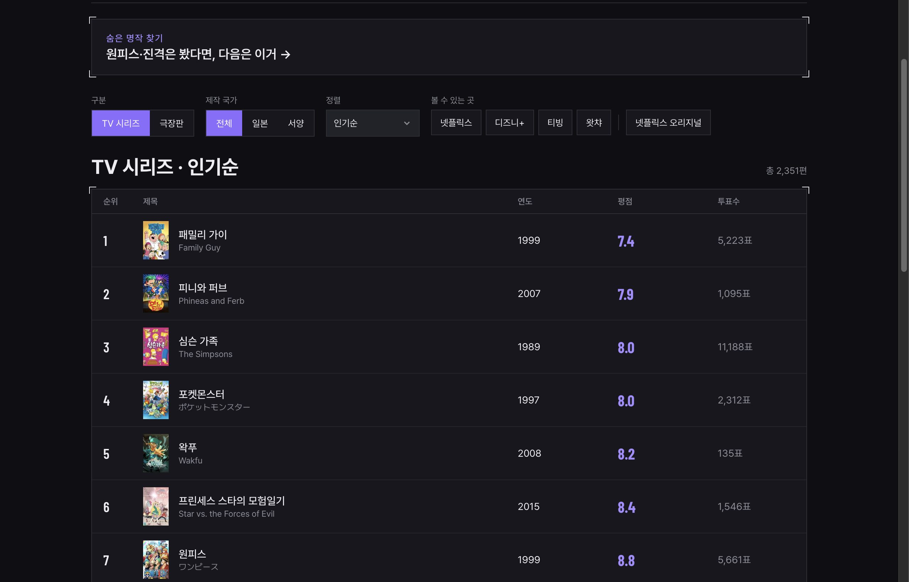
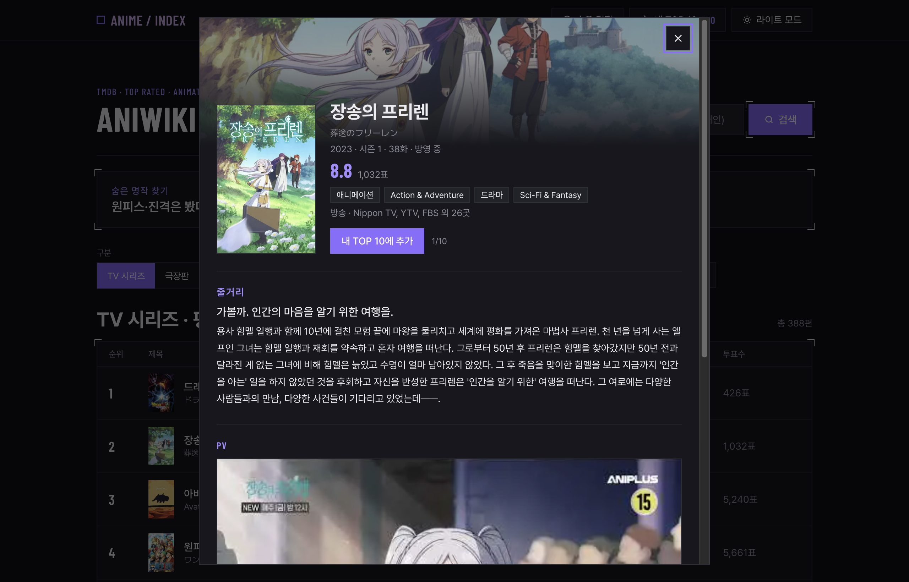
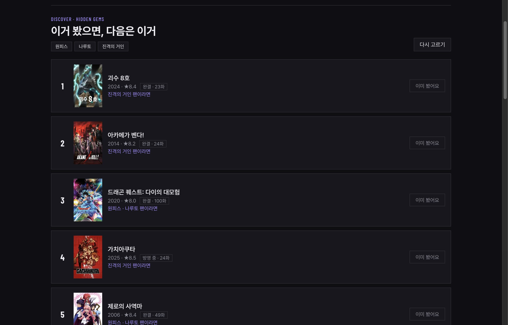
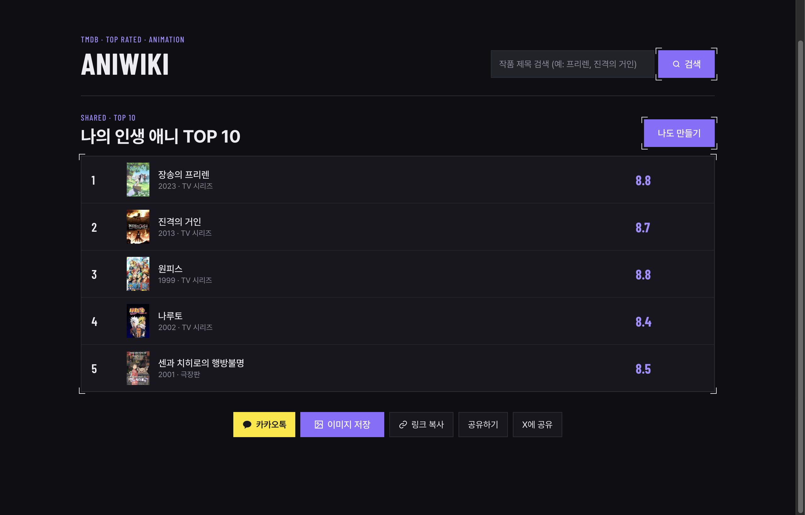
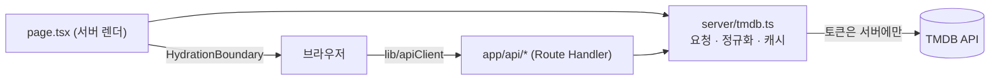

# ANIWIKI

**한국에서 볼 수 있는 애니메이션을 평점 · 인기 순위로 찾아 주는 사이트**

🔗 **https://www.aniwiki.link**



## 왜 만들었나

애니메이션 평점은 해외 사이트에 모여 있고, 그 작품을 한국 어느 OTT에서 볼 수 있는지는 따로 찾아야 합니다. 넷플릭스 오리지널인지, 유명작을 다 본 뒤에 볼 만한 작품이 무엇인지도 한 번에 알기 어렵습니다.

ANIWIKI는 TMDB 데이터를 한국 기준으로 다시 걸러서 이런 질문에 한 화면으로 답합니다.

- 지금 **내가 구독한 OTT**(넷플릭스 · 디즈니+ · 티빙 · 왓챠)에서 볼 수 있는 작품 중 평점이 높은 것은?
- 한국 넷플릭스에 있는 **진짜 넷플릭스 오리지널**은?
- 원피스 · 진격의 거인을 봤다면 **다음에 볼 숨은 명작**은?

## 주요 기능

| 작품 상세                            | 숨은 명작 찾기                         | 공유 TOP 10                           |
| ------------------------------------ | -------------------------------------- | ------------------------------------- |
|  |  |  |

- **랭킹 · 검색**: TV 시리즈 / 극장판, 평점 · 인기 · 투표수 · 최신순, 제작 국가(일본 · 서양), 시청 가능한 OTT로 거르기. 조건은 주소에 남아 새로고침하거나 링크를 공유해도 유지됩니다.
- **넷플릭스 오리지널 모아 보기**: TMDB 데이터를 그대로 믿지 않고 자체 규칙으로 판별합니다([트러블슈팅](#트러블슈팅) 참고).
- **작품 상세**: 줄거리 · PV 영상 · 한국 시청처. 앱 안에서는 모달로 열고, 주소로 바로 들어오면 서버에서 그린 페이지로 보여 줍니다(검색엔진 · 링크 미리보기 대응).
- **숨은 명작 찾기**: 본 유명작을 고르면 그 작품들의 TMDB 추천을 합산해서, 평점은 높지만 덜 알려진 작품 20편을 추천합니다.
- **나만의 인생 애니 TOP 10**: 담고, 순서를 바꾸고, 이미지(Canvas) · 링크 · 카카오톡 · X로 공유합니다.
- 다크 모드, 모바일 레이아웃, 사이트맵 · canonical 같은 SEO 설정.

## 기술 스택과 선택 이유

| 기술                          | 이유                                                                                                                                                                                                                             |
| ----------------------------- | -------------------------------------------------------------------------------------------------------------------------------------------------------------------------------------------------------------------------------- |
| **Next.js 16** (App Router)   | 처음엔 Vite SPA였는데, TMDB 토큰을 브라우저에서 빼고 작품 상세를 서버에서 그리려고 옮겼습니다. Route Handler가 TMDB 프록시 역할을 하고, 인터셉트 라우트로 "앱 안에서는 모달, 주소로 들어오면 페이지"를 한 컴포넌트로 처리합니다. |
| **TanStack Query v5**         | "더 보기" 무한 페이지네이션, 캐시, 서버에서 미리 받은 데이터 넘기기(`HydrationBoundary`)를 한 라이브러리로 해결합니다.                                                                                                           |
| **zustand**                   | 내 TOP 10 · 모달 상태를 전역으로 두되, 컴포넌트가 필요한 값만 골라 구독해서 불필요한 리렌더를 줄입니다. `persist`로 localStorage 저장도 함께 처리합니다.                                                                         |
| **TypeScript** (strict)       | JS에서 옮겼습니다. 정렬 · 국가 같은 상수에서 타입을 뽑아 써서, 상수만 고치면 타입도 따라 바뀝니다.                                                                                                                               |
| **CSS Modules** + 디자인 토큰 | 런타임 비용 없이 컴포넌트별로 스타일을 격리하고, `[data-theme]`로 다크 모드를 전환합니다.                                                                                                                                        |
| **Vercel**                    | `main`에 푸시하면 바로 배포되고, ISR(하루마다 갱신)과 Web Analytics를 씁니다.                                                                                                                                                    |

## 구조



```
src/
├── app/          라우팅만 (페이지, API 라우트, @modal 인터셉트 모달, sitemap)
├── server/       서버 전용 (TMDB 요청 · 넷플릭스 오리지널 목록 · 사이트맵)
├── lib/          상수 · 순수 함수 (정렬/국가 카탈로그, 사이트 주소 · 제목, 다크 색, 주소 파싱, 공유, 숨은 명작 점수)
├── hooks/        React Query 훅 등
├── stores/       zustand (내 TOP 10, UI 상태)
├── components/   랭킹 화면(Home · Filters · RankingTable)과 기능별 폴더 (detail · top10 · discover · layout · common)
└── styles/       디자인 토큰 · 공통 스타일
```

## 트러블슈팅

**1. 넷플릭스 오리지널이 아닌 작품이 오리지널로 나왔다**

- 문제: TMDB에서 방송사(network)가 Netflix인 작품을 오리지널로 표시했더니, 「타코피의 원죄」처럼 한국에서는 라프텔 독점인 작품이 섞였습니다.
- 원인: TMDB의 network 213은 "어느 나라든 넷플릭스에서 방영"이라는 뜻일 뿐, 오리지널이라는 뜻이 아니었습니다.
- 해결: 판별 규칙을 따로 만들었습니다(`lib/netflix.ts`).
  - TV: 방송사가 넷플릭스 하나뿐일 때
  - 극장판: 15개국 이상에 넷플릭스로 공개됐고, 극장 개봉이 그보다 먼저가 아닐 때
  - 공통: 넷플릭스 제작사가 참여했을 때
- 이 판별에는 작품마다 상세 정보가 필요해서, 서버가 빌드 때와 하루에 한 번 목록을 만들어 둡니다(ISR).

**2. TMDB 토큰이 브라우저에 노출됐다**

- 문제: Vite SPA에서는 TMDB를 브라우저가 직접 불러서, 토큰이 번들에 포함됐습니다.
- 해결: Next.js로 옮기고 모든 TMDB 요청을 서버 Route Handler로 보냈습니다. 서버 코드에는 `server-only`를 걸어, 실수로 클라이언트에서 import하면 빌드가 실패하게 했습니다.

**3. localStorage 값 때문에 하이드레이션 오류가 났다**

- 문제: 내 TOP 10 · 선택한 OTT는 localStorage에 있는데, 서버는 이 값을 모릅니다. 그래서 서버 HTML과 브라우저 첫 화면이 달라졌습니다.
- 해결:
  - 일반 값은 `useSyncExternalStore`로 읽습니다. 서버용 값과 브라우저용 값을 따로 줄 수 있어서, 하이드레이션이 끝난 뒤에 저장된 값으로 바뀝니다.
  - zustand는 `skipHydration`으로 자동 복원을 끄고, 마운트 후에 `rehydrate()`합니다.

**4. TMDB에는 있다고 나오는데 한국에서 볼 수 없었다**

- 문제: 크런치롤은 TMDB 한국 시청처에 자주 나오지만, 실제로는 한국에서 대부분 재생되지 않습니다. 라프텔은 TMDB에 아예 없습니다.
- 해결: 크런치롤은 필터와 상세에서 숨기고, 상세에 「라프텔에서 검색」 링크를 따로 달았습니다.

**5. 카카오톡 공유 카드가 뜨는데 눌러도 열리지 않았다**

- 원인: 카카오 디벨로퍼스에서 도메인을 두 곳에 등록해야 하는데, 한 곳이 빠져 있었습니다.
  - 플랫폼 키 > JavaScript 키 > JavaScript SDK 도메인
  - 앱 > 제품 링크 관리 > 웹 도메인
- 해결: 두 곳 모두에 도메인을 등록했습니다.

## 로컬에서 실행

Node.js 20.9 이상이 필요합니다.

```bash
git clone https://github.com/Seop2/aniwiki.git
cd aniwiki
npm install
cp .env.example .env
```

`.env`에 [TMDB API 설정](https://www.themoviedb.org/settings/api)에서 받은 값을 넣습니다.

- `TMDB_TOKEN`(API Read Access Token)이나 `TMDB_API_KEY` 둘 중 하나만 있으면 됩니다.
- `NEXT_PUBLIC_KAKAO_JS_KEY`는 선택입니다. 없으면 카카오톡 공유 버튼이 숨겨집니다.

```bash
npm run dev          # http://localhost:3000
npm run typecheck    # 타입 검사
npm run build && npm start   # 배포용 빌드 확인
```

<details>
<summary>기타 참고</summary>

- 숨은 명작 기준값(평점 · 투표 수 · 방영 후 경과 기간 등)은 `lib/discover.ts`의 `GEM` 상수에 있습니다.
- TMDB discover API는 최대 500페이지까지만 조회됩니다.
- `public/og-image.png`는 `scripts/og-image.html`을 아래 명령으로 캡처해서 다시 만듭니다.

```bash
"/Applications/Google Chrome.app/Contents/MacOS/Google Chrome" --headless --hide-scrollbars \
  --window-size=1200,630 --virtual-time-budget=5000 \
  --screenshot=public/og-image.png scripts/og-image.html
```

</details>

## 만든 사람 · 데이터 출처

- 만든 사람: [Seop2](https://github.com/Seop2)
- 작품 정보 · 이미지: [TMDB](https://www.themoviedb.org). This product uses the TMDB API but is not endorsed or certified by TMDB.
